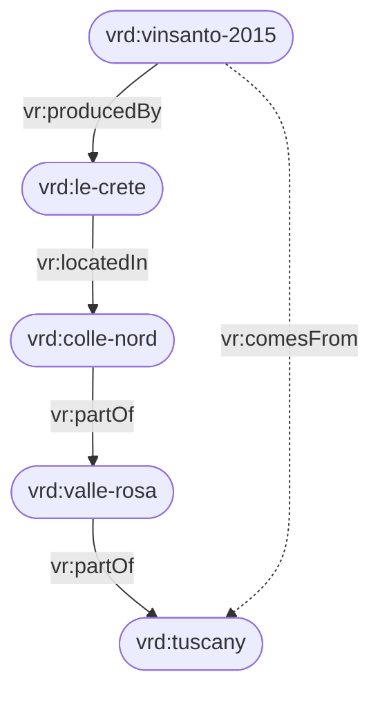

Vallerosa is a cooperative of three family wineries in a Tuscan valley, the running example of the [RDFSharp manual](https://mdesalvo.github.io/RDFSharp/vallerosa/). The cooperative, its wineries and its wines are fictional; the grapes and the regions are real. Every IRI lives under `vallerosa.example`, a domain reserved for examples.

## The files

<div class="cards">
  <a class="card" href="{{ '/assets/data/vallerosa.owx' | relative_url }}"><span class="kind">OWL2/XML · 268 axioms</span><h3>vallerosa.owx</h3><p>The ontology: classes, properties, individuals and what relates them. Every example loads it.</p></a>
  <a class="card" href="{{ '/assets/data/vallerosa.omn' | relative_url }}"><span class="kind">Manchester · 268 axioms</span><h3>vallerosa.omn</h3><p>The same ontology in Manchester syntax, the easiest to read.</p></a>
  <a class="card" href="{{ '/assets/data/vallerosa-vocab.ttl' | relative_url }}"><span class="kind">Turtle · RDF Schema</span><h3>vallerosa-vocab.ttl</h3><p>The vocabulary of the RDFSharp manual, as it was.</p></a>
  <a class="card" href="{{ '/assets/data/vallerosa-catalog.ttl' | relative_url }}"><span class="kind">Turtle · RDF</span><h3>vallerosa-catalog.ttl</h3><p>The catalog of the RDFSharp manual, as it was.</p></a>
</div>

The two Turtle files are where the ontology comes from: [From RDF to OWL]({{ '/modeling/from-rdf/' | relative_url }}) lifts them, step by step. The two ontology files are written by OWLSharp itself and carry the same 268 axioms.

| Prefix | Namespace | Holds |
|---|---|---|
| `vr:` | `https://vallerosa.example/vocab#` | the vocabulary |
| `vrd:` | `https://vallerosa.example/id/` | the individuals |
| `dbr:` | `http://dbpedia.org/resource/` | the DBpedia resources of the grapes |

## Wineries and places

| Winery | Subzone | Makes |
|---|---|---|
| Fattoria Poggio Alto (`vrd:poggio-alto`) | Hilltop (`vrd:poggio`) | the two reds |
| Tenuta Le Crete (`vrd:le-crete`) | North Hill (`vrd:colle-nord`) | the white blend and the Vin Santo |
| Cantina dei Tre Ulivi (`vrd:tre-ulivi`) | The Plain (`vrd:piana`) | the Vermentino and the rosé |

The three subzones are `vr:partOf` the valley `vrd:valle-rosa`, which is part of Tuscany, which is part of Italy. In the RDFSharp manual a query walked this chain with a property path. Here the ontology knows it: `vr:partOf` is transitive and `vr:comesFrom` follows a wine to its producer, to the producer's subzone and up through every area that contains it.



## The wines

| Wine | Type | Vintage | Alcohol | Price (€) | Organic | Grapes |
|---|---|---|---|---|---|---|
| `vrd:rosso-2021` Vallerosa Red | `vr:RedWine` | 2021 | 13.5 | 14.50 | no | Sangiovese, Canaiolo |
| `vrd:riserva-2019` Vallerosa Reserve | `vr:RedWine` | 2019 | 14.0 | 32.00 | no | Sangiovese |
| `vrd:bianco-2023` Le Crete White | `vr:WhiteWine` | 2023 | 12.0 | 11.00 | yes | Trebbiano, Malvasia |
| `vrd:vinsanto-2015` Valley Vin Santo | `vr:SweetWine` | 2015 | 16.0 | 38.00 | no | Trebbiano, Malvasia |
| `vrd:vermentino-2023` Vermentino of the Plain | `vr:WhiteWine` | 2023 | 12.5 | 13.00 | yes | Vermentino |
| `vrd:rosato-2024` Valley Rosé | `vr:RoseWine` | 2024 | 12.0 | 10.00 | no | Sangiovese |

One of them as the ontology writes it, in Manchester syntax:

```manchester
Individual: vrd:vinsanto-2015
    Facts: vr:producedBy vrd:le-crete, vr:grape vrd:trebbiano, vr:grape vrd:malvasia, vr:alcohol "16.0"^^xsd:decimal, vr:price "38.00"^^xsd:decimal, vr:organic "false"^^xsd:boolean, vr:vintage "2015"^^xsd:integer, vr:method vrd:appassimento
    Types: vr:SweetWine
    Annotations: rdfs:label "Vin Santo della Valle"@IT, rdfs:label "Valley Vin Santo"@EN
```

The Vin Santo is the one wine of the catalog made from dried grapes: `vr:method vrd:appassimento` says so, which the RDFSharp catalog did not.

## What the ontology adds

The classes and the properties are those of the RDFSharp vocabulary. OWL2 lets the ontology say what RDF Schema could not:

| The ontology says | In OWL2 | Chapter |
|---|---|---|
| a part of a part is a part | `vr:partOf` is transitive | [Object property axioms]({{ '/modeling/object-properties/' | relative_url }}) |
| a winery produces a wine exactly when the wine is produced by the winery | `vr:produces` is the inverse of `vr:producedBy` | [Object property axioms]({{ '/modeling/object-properties/' | relative_url }}) |
| a wine has one producer | `vr:producedBy` is functional | [Object property axioms]({{ '/modeling/object-properties/' | relative_url }}) |
| a wine comes from the area of its producer and from every area containing it | `vr:producedBy o vr:locatedIn` and `vr:comesFrom o vr:partOf` are sub-properties of `vr:comesFrom` | [Object property axioms]({{ '/modeling/object-properties/' | relative_url }}) |
| a red wine is never a white wine nor a rosé | `DisjointClasses: vr:RedWine, vr:WhiteWine, vr:RoseWine` | [Class axioms]({{ '/modeling/class-axioms/' | relative_url }}) |
| a wine is never a winery, an area or a grape | the nine top classes are disjoint | [Class axioms]({{ '/modeling/class-axioms/' | relative_url }}) |
| a Tuscan wine is a wine that comes from Tuscany | `vr:TuscanWine` is equivalent to `vr:Wine and (vr:comesFrom value vrd:tuscany)` | [Class expressions]({{ '/modeling/class-expressions/' | relative_url }}) |
| an organic wine is a wine whose organic flag is true | `vr:OrganicWine` is equivalent to `vr:Wine and (vr:organic value true)` | [Class expressions]({{ '/modeling/class-expressions/' | relative_url }}) |
| a wine has one vintage, one alcohol, one price and one organic flag | the four data properties are functional | [Data properties and datatypes]({{ '/modeling/data-properties/' | relative_url }}) |
| an alcohol content is a decimal from 0 to 20 | the datatype `vr:abv` is `xsd:decimal[>= 0, <= 20]`, the range of `vr:alcohol` | [Data properties and datatypes]({{ '/modeling/data-properties/' | relative_url }}) |
| a grape of the catalog is the grape DBpedia describes | `SameIndividual: vrd:sangiovese, dbr:Sangiovese` and the like | [Individuals and assertions]({{ '/modeling/assertions/' | relative_url }}) |

No wine of the files is said to be a Tuscan wine or an organic wine: the [reasoner]({{ '/reasoning/reasoner/' | relative_url }}) finds them.

## What stays in RDF

A few things of the RDFSharp manual are not in the ontology, because they are RDF structures that OWL2 does not model: the ordered blend of a wine (`vr:blend`, an `rdf:List`), its awards (`vr:awards`, an `rdf:Bag`) and the claims of the sommelier (`vr:claims`, reified statements). The vintages changed type on the way: the catalog writes them as `xsd:gYear`, the ontology as `xsd:integer`, because `xsd:gYear` is outside the OWL2 datatype map and so not allowed in OWL 2 DL. The scores of the guides and the sales to the shops stay in the stores of the RDFSharp manual.
